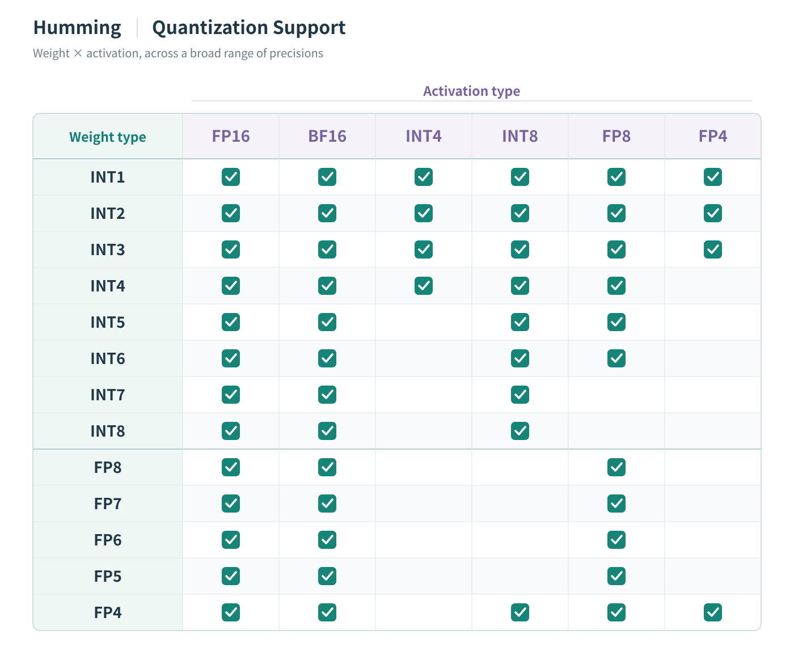
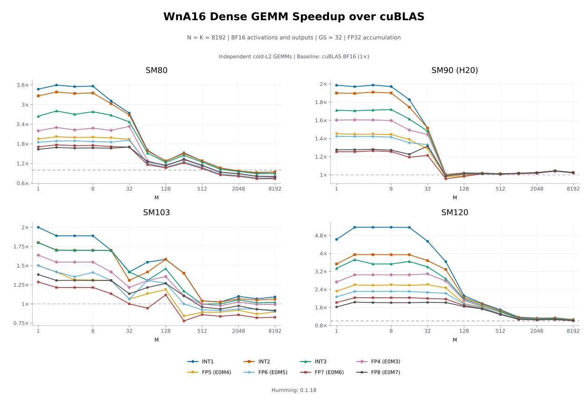
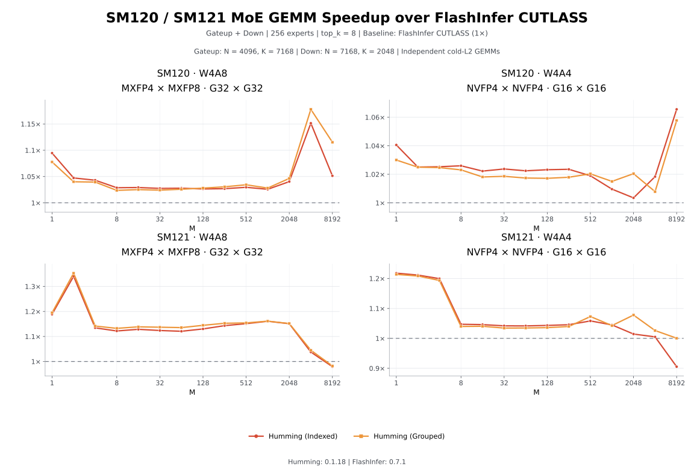

# Humming：高性能、灵活的量化推理内核

为了让不同模型在广泛的设备上都能高效运行量化推理，蚂蚁集团与 vLLM 社区 合作开发了 Humming，一个通用、高性能的量化推理算子库。依托统一架构，Humming 将不同设备、量化格式以及 Dense 和 MoE 计算纳入同一套框架，覆盖主流设备上的绝大多数量化推理需求。在本文展示的多项基准测试中，Humming 的性能显著优于 vLLM Marlin、FlashInfer 和 DeepGEMM 等现有实现，让广泛的场景支持与出色的执行效率兼得。

项目仓库：[github.com/vllm-project/humming](https://github.com/vllm-project/humming)

## 背景

随着模型规模与推理负载的增长，显存容量、访存带宽和计算成本日益成为部署的制约因素。这一问题在 MoE 模型中尤为明显：每个 token 只激活部分专家，但仍需存储全部权重。例如，DeepSeek-V3 拥有 6710 亿参数，每个 token 激活其中的 370 亿。量化通过降低权重与激活的表示精度，减少显存占用和数据搬运，也有助于提高计算效率。

不同模型和 GPU 架构的量化需求各不相同。常见配置包括 WNA16、W8A8、W4A8 和 W4A4，其中 W 和 A 分别标识权重与激活的位宽，N 表示可变的权重位宽。即使位宽相同，INT4 和 NVFP4 等方案在数值格式和缩放方式上也存在差异。缩放粒度、缩放因子的表示方式、分组大小，以及对称或非对称量化进一步扩大了配置空间。

这些存储与计算上的收益需要通过高效内核，才能转化为更低的延迟和更高的吞吐。Prefill、Decode 和不同的 MoE 专家负载对计算与访存有不同要求。内核既要适应这些负载，也要控制数据转换、反量化和调度的开销。

为每种组合开发并接入专用内核，会带来不断增长的维护负担。每新增一种组合，都可能需要独立的权重预处理、内核选择、框架适配和测试，已有优化也需要同步到多个实现中。

Humming 将量化描述与执行策略分离，并通过共享组件构建内核，以应对这一问题。

## 通用架构

Humming 的执行路径包含三个环节：表示量化计算，根据硬件与负载选择配置，再通过 CUDA 组件编译生成内核。

### 统一量化表示

不同量化工具导出的模型在数值格式、参数组织和权重布局上各有差异。Humming 将支持的导出格式转换为 Humming 标准格式：一组通用的量化描述，以及按统一约定组织的权重、缩放因子、零点和其他张量。

<p align="center">
  <a href="humming-quantization-format-en.svg"></a>
</p>

这一表示保留各方案的量化语义，将权重格式、缩放粒度、缩放因子的数据类型、零点和二级缩放因子分别表示为独立参数。激活拥有自己的数值格式与量化设置。这些参数可以在格式与硬件约束内组合。

例如，采用分组缩放的 INT4 权重可以搭配 BF16 激活；采用不同缩放方式的低精度浮点权重也使用同一套参数体系。这为推理框架处理不同来源的模型提供了统一接口。

### 按负载调优与 JIT 编译

标准格式为不同导出格式提供统一表示。随后，预处理完成参数校验、维度对齐，并将这些张量重排为适合目标内核的布局。Humming 结合量化描述、权重形状、GEMM 类型、目标 GPU 和计算选项，确定执行配置。

<p align="center">
  <a href="humming-jit-inference-en.svg"></a>
</p>

内核由三类配置描述：

- **Layer Config** 描述张量形状、数据类型、量化参数和目标架构。
- **Compute Config** 指定 GEMM 类型和计算选项，例如批次不变性与输入缩放布局。
- **Tuning Config** 选择分块形状、流水线级数、Warp 分工模式、访存方式和 MMA 指令，同时控制并发与调度；TMA 可按张量独立配置。

默认情况下，Humming 根据设备特定的启发式规则选择调优配置。它可以为不同输入规模区间准备不同配置，并在运行时分派到合适的内核。

Humming 的统一架构使其能够方便地为不同负载调整执行参数、选择流水线。在小批量下，使用异步拷贝（`cp.async`）和 MMA 的多级流水线可能优于基于 TMA 与 UMMA 的流水线；在大批量下，TMA 与 UMMA 则可能提供更高的吞吐。Humming 在同一套配置与组件框架内支持这两种执行路径，从而为不同负载选择更有效的策略。

这三类配置共同用于特化由 NVRTC 或 NVCC 编译的内核，编译结果会被缓存以供复用。推理时，选定的内核使用预处理后的权重和运行时激活完成计算。

### 跨格式与架构共享 CUDA 组件

在 CUDA 层，Humming 将任务调度、数据搬运、反量化与缩放、Tensor Core 计算和输出处理组织为可复用组件，并提供常规流水线、Warp Specialization 流水线和 UMMA 专用流水线。这些流水线共享适用的组件，同时采用各自执行策略所需的数据流与同步方式。

<p align="center">
  <a href="humming-cuda-architecture-en.svg"></a>
</p>

各组组件分别处理不同来源的差异：

- **数值处理组件适配量化格式。** 解码与算术组件处理位宽、整数或浮点表示、缩放因子和零点等差异，反量化与缩放融入内核计算过程。
- **访存与计算后端适配 GPU 架构。** Humming 根据目标架构选择数据搬运与 Tensor Core 实现，并在支持的场景中使用异步拷贝、TMA 和多播。
- **任务映射与调度适配 Dense 和 MoE 负载。** 每种 GEMM 类型采用相应的调度逻辑，缩放和偏置加法也可以融合到输出阶段。

JIT 编译依据三类配置组合这些组件，并消除未使用的实现分支。因此，支持新格式或新架构可以通过扩展相关组件完成。共享组件的改进能够使适用的配置受益，减少多套专用内核带来的重复开发与维护。

### 基于设备参数的性能调优

Humming 结合 GEMM 配置与设备参数，对内核进行深度优化。从量化格式、矩阵形状到 GPU 的指令能力、SM 数量、共享内存与寄存器资源，Humming 将这些因素共同纳入执行策略，让低比特存储的优势转化为实际的推理性能。

**让已有 GPU 也能高效运行 W4A8-MXFP4。** Blackwell 之前的架构缺少原生 MXFP4 Tensor Core 计算支持，常规 W4A8-MXFP4 内核在 M 较大时容易受到反量化与缩放开销的限制。为此，Humming 设计了 MXFP4 到 INT8/FP8 的快速反量化路径，在内核中将 MXFP4 权重高效转换为设备支持的计算格式。在这一场景下，该路径在小 M 时明显优于常规 W4A8 实现，在大 M 时则与 W8A8 的性能基本持平。这使 H200 等 GPU 也能在保留 4-bit 权重存储优势的同时，运行高性能的 W4A8-MXFP4 算子。

**为不同设备选择合适的反量化路径。** 相同的量化格式，在不同 GPU 上也可能需要不同的实现。Humming 根据设备能力选择解码、数值转换与缩放路径，并与对应的访存方式和计算流水线配合，减少反量化过程中的指令与数据搬运开销。共享组件使这些优化能够复用于适用的 Dense 与 MoE 内核。

**用丰富参数与设备专属启发式适配不同负载。** Humming 开放分块形状、流水线级数、Warp 分工、TMA、MMA 指令、CTA 并发度及 Stream-K 调度等调优参数。针对不同设备，启发式逻辑结合 GEMM 形状与资源约束，在并行度、数据复用和流水线开销之间选择合适的配置，并随输入规模切换执行策略。开发者既可以直接使用默认配置，也可以针对特定模型和部署场景进一步调优。

## 使用方法

### 安装

通过 pip 安装 Humming：

```bash
pip install humming-kernels
```

Humming 使用 CUDA 编译器按需生成内核。如果系统中没有可用的 CUDA 编译器，可以根据环境的 CUDA 主版本，选择以下一种方式一并安装编译依赖：

```bash
pip install "humming-kernels[cu12]"  # CUDA 12
pip install "humming-kernels[cu13]"  # CUDA 13
```

Humming 本身极其轻量，依赖简单，wheel 安装包仅约 500 KB。得益于按需编译的设计，安装时无需携带庞大的预编译内核。理论上，能够运行 PyTorch 2.7 的环境都可以使用 Humming，方便接入已有的推理环境。

### 在 vLLM 中使用

Humming 已与 vLLM 深度集成。用户可以通过 `--linear-backend` 和 `--moe-backend`，分别选择 Humming 作为 Dense GEMM 和 MoE GEMM 的计算后端。例如，同时为两类计算启用 Humming：

```bash
vllm serve openai/gpt-oss-20b --linear-backend humming --moe-backend humming
```

对于 vLLM 尚未原生支持解析、但 Humming 支持的量化 checkpoint，也可以尝试通过 `--quantization humming` 显式选择 Humming 的量化加载路径：

```bash
vllm serve openai/gpt-oss-20b --quantization humming
```

### 选择激活类型

默认情况下，Humming 沿用 checkpoint 中设定的激活类型，并根据设备能力自动适配。如果 GPU 不支持对应的计算类型，Humming 会回退到设备支持的更高精度类型。例如，在不支持原生 MXFP4 计算的设备上，可以自动选择 FP8、BF16 或 FP16 计算路径，让同一份量化 checkpoint 适配不同代际的 GPU。

用户也可以通过 vLLM 的量化配置接口覆盖默认设置，按部署需求选择激活类型。以下示例将 MoE 层的激活类型指定为 MXFP8：

```bash
vllm serve openai/gpt-oss-20b --moe-backend humming --quantization-config.moe.activation mxfp8
```

## 结果

### 广泛的设备支持

得益于统一架构，Humming 能够覆盖广泛的 GPU 设备。对于 NVIDIA GPU，Humming 完整支持从 Turing 起的所有 GPU 架构，让不同代际的设备都能使用同一套量化计算框架。

统一的 JIT 架构也让 Humming 能够方便地扩展到兼容 CUDA 编程的其他 GPU。目前，Humming 已完整支持平头哥 Zhenwu 810E，将统一的内核与调优能力带到更多硬件平台。

下图列出了 Humming 在各类设备上支持的高性能激活类型，即能够充分发挥对应设备最高计算性能的类型。部分未列出的类型仍可通过其他指令路径运行。例如，B300（SM103）的 UMMA 指令不再支持 INT8 计算，但仍可使用较早的 MMA 指令执行 INT8 GEMM，只是性能会明显降低。

<p align="center">
  <a href="humming-device-support-en.svg"></a>
</p>

### 量化支持

Humming 对量化类型的支持主要取决于激活类型与权重类型是否兼容。统一的量化表示与内核架构，让多种整数和浮点权重格式能够搭配不同精度的激活参与计算，为模型部署提供灵活的精度与性能选择。

下图展示了 Humming 支持的权重类型与激活类型组合：行表示权重类型，列表示激活类型，勾选表示支持对应组合。结合上一节的设备支持矩阵，即可了解各类硬件上可用的高性能量化计算路径。

<p align="center">
  <a href="humming-quantization-support-en.svg"></a>
</p>

Humming 还支持一种指数位数为 0 的特殊浮点格式，其取值范围等价于相同位宽的对称整数。例如，排除 `-128` 的 INT8 与 `float8e0m7` 都表示 `-127` 到 `127` 的整数。这类权重与激活类型的兼容性等同于相同位宽的 INT 权重。对于符合转换条件的对称整数权重，Humming 会自动将其转换为这种格式，以加快反量化。

在原生硬件计算方面，社区还发现了 Blackwell Tensor Core 的两项隐藏能力：支持 `float4e0m3` 和 `float8e3m4` 这两种未在 PTX 类型系统中公开的特殊浮点格式。Humming 已在所有 Blackwell 架构上支持这些特性，包括数据中心的 SM100/SM103，以及面向工作站与个人计算设备的 SM120/SM121，并将其纳入统一的量化与计算框架，为低精度推理提供更多原生计算选择。Rubin 不支持这两种隐藏的 Tensor Core 格式，因此这些原生计算路径的支持范围不延伸至 Rubin。

### 性能

以下测试聚焦 GEMM 内核性能，M 覆盖从 1 到 8192 的所有 2 的幂。各内核充分预热后，在冷 L2 缓存下独立计时，采样之间短暂间隔；MoE 以 Gateup 与 Down 两次 GEMM 的合计耗时计算加速比。各图标明对应的比较基准、量化格式、计算维度和软件版本。

#### WnA16

WnA16 是当前通用性最强、应用最广泛的量化方法之一。它将低比特权重与 FP16/BF16 激活相结合，既降低权重存储与访存开销，又能复用广泛部署的 16-bit 计算能力，适用于不同代际的 GPU 和丰富的模型部署场景。其中，W4A16 系列尤其受到社区关注，也是 Humming 重点优化的计算路径。

在 Dense W4A16 上，Humming 在多数测试配置中领先或持平于 vLLM Marlin，并在 Hopper 和 Blackwell 的部分负载中取得显著优势。下图以 cuBLAS 为共同基准：小批量时，Humming 在部分设备上达到约 3–4 倍的加速；随着批量增大，它仍能高效利用设备算力，在 H200 的大批量场景下达到约两倍于 Marlin 的性能，在 B300 的部分场景中则超过三倍。

<p align="center">
  <a href="humming-w4a16-performance-en.svg"></a>
</p>

这一优势也延伸到了 MoE。面对专家分散、每个专家计算规模随负载变化的特点，Humming 同时提供高效的 Indexed 和 Grouped 路径。下图中，H20 和 H200 上的 MXFP4 W4A16 在部分中大批量场景达到约两倍于 Marlin 的性能；B300 上的 MXINT4 和 NVFP4 路径在大批量下进一步拉开差距，Grouped 路径最高达到约五倍。SM120 和 SM121 上的结果也表明，Humming 能在多种负载下超越 Marlin 和 FlashInfer 的对应实现。

<p align="center">
  <a href="humming-w4a16-moe-performance-en.svg"></a>
</p>

Humming 的优化同样覆盖 W4A16 之外的 WnA16 组合。统一的反量化与计算路径，让 INT1、INT2、INT3，以及 FP4 到 FP8 等不同位宽的整数和浮点权重都能获得良好的执行效率。下图中，各类格式在中小批量下展现出广泛的加速收益，SM120 上的低位宽配置最高超过五倍于 BF16 cuBLAS 的性能；在 H20 的大批量场景中，多种位宽则保持接近 BF16 cuBLAS 的计算效率。这让模型能够在精度、存储和吞吐之间进行更细粒度的选择。

<p align="center">
  <a href="humming-wna16-performance-en.svg"></a>
</p>

#### W8A8 / W4A8 / W4A4

从 Hopper 开始，采用块级缩放的 FP8 W8A8 逐渐成为高性能量化推理的主流方案之一。Humming 通过对数据搬运、缩放计算和专家调度的协同优化，在这一成熟的计算路径上进一步提升效率。下图左列展示了 H20 和 H200 上的 W8A8 表现：在中小批量下，Humming 相对 DeepGEMM Contiguous 的性能分别最高达到约 1.8 倍和 1.4 倍，Indexed 与 Grouped 两种布局都具有竞争力。

<p align="center">
  <a href="humming-w8a8-w4a8-hopper-performance-en.svg"></a>
</p>

随着越来越多模型原生采用 MXFP4 权重量化，如何将更小的权重存储转化为实际推理收益也变得更加重要。Humming 为此设计了高效的 W4A8 路径，在加载 MXFP4 权重的同时完成快速反量化，并利用 FP8 Tensor Core 执行计算，让 Hopper 也能高效运行 W4A8-MXFP4。上图右列仍以 DeepGEMM W8A8 为基准：在中小批量下，Humming 的 W4A8 在 H20 上最高达到约 2.9 倍、在 H200 上约 2.5 倍的性能，也明显快于同图中的 Humming W8A8。更低的权重访存开销由此转化为更低的 GEMM 延迟。

Blackwell 进一步将 MXFP8、MXFP4 等微缩放格式纳入原生 Tensor Core 计算支持。从数据中心的 SM100/SM103，到面向工作站与个人计算设备的 SM120/SM121，Humming 利用各架构对应的低精度计算能力，将 W8A8、W4A8 和 W4A4 纳入同一套内核与调优框架。

在 B300（SM103）上，Humming 的三类 MX 格式计算都展现出明显的性能优势。以下各子图以对应精度的 DeepGEMM Contiguous 为基准，中小批量下的 W8A8、W4A8 和 W4A4 分别最高达到约 1.25 倍、1.6 倍和 1.4 倍的性能，并在多种负载下领先 FlashInfer 的对应实现。Indexed 与 Grouped 路径都能从原生低精度计算中受益，为不同专家布局提供高效选择。

<p align="center">
  <a href="humming-mx-moe-sm103-performance-en.svg"></a>
</p>

这种性能收益也覆盖 SM120 和 SM121。以下结果中，Humming 的 MXFP4 × MXFP8 W4A8 与 NVFP4 × NVFP4 W4A4 在多数测试点优于 FlashInfer CUTLASS。在 SM121 的小批量场景中，W4A8 的性能提升最高约为 35%，W4A4 约为 20%；SM120 上也在多数计算规模下保持领先。统一架构由此将低精度推理的优化带到更多设备，让数据中心之外的平台也能获得高效的量化计算能力。

<p align="center">
  <a href="humming-w4a8-w4a4-sm12x-performance-en.svg"></a>
</p>

## 未来计划

### 更完善的设备支持

Humming 将继续扩展统一架构的硬件覆盖，并深入适配新设备的计算与访存能力，让更多平台充分释放量化推理的性能潜力。接下来的重点包括：

- 支持 Rubin 架构的更多新特性，包括 Locality Domains，进一步优化任务映射与数据访问。
- 扩展对更多平头哥 PPU 设备的支持，包括 Zhenwu M890。
- 支持更多兼容 CUDA 编程的设备，将已有的量化格式、内核组件与调优能力带到更多硬件平台。

### 添加 Autotune

经过针对性调优，Humming 已能在多数场景达到 SOTA 级别的性能。但模型形状、量化配置与设备资源的组合十分丰富，启发式逻辑难以在所有情况下都选出最优配置。

为此，Humming 计划引入 autotune，通过在目标设备上实测候选配置，为具体负载寻找更合适的执行参数。自动调优将与现有启发式互补，减少手动搜索配置的成本，让更多场景接近内核的最佳性能。
