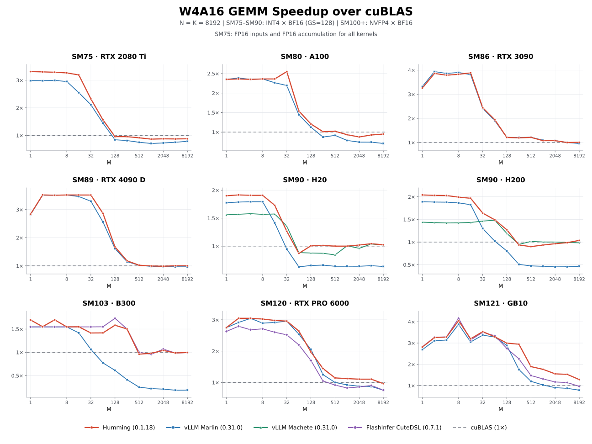
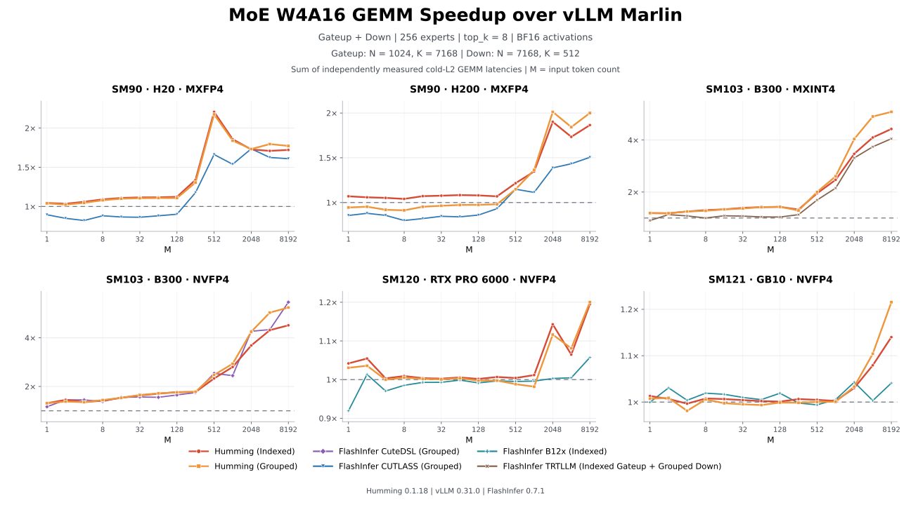
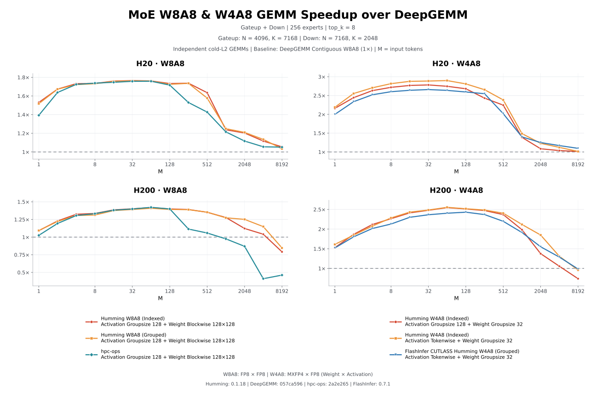
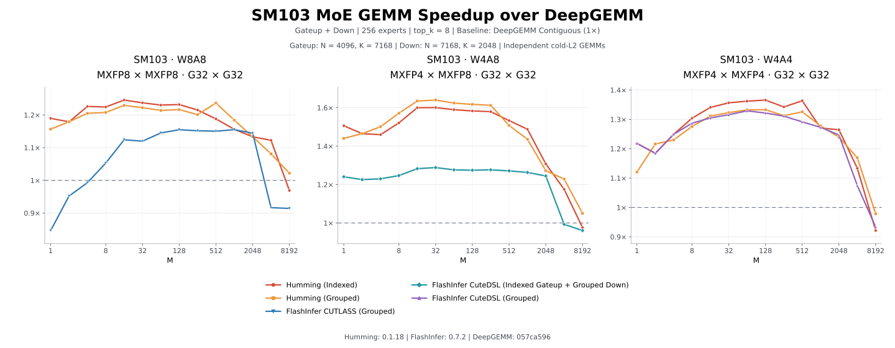
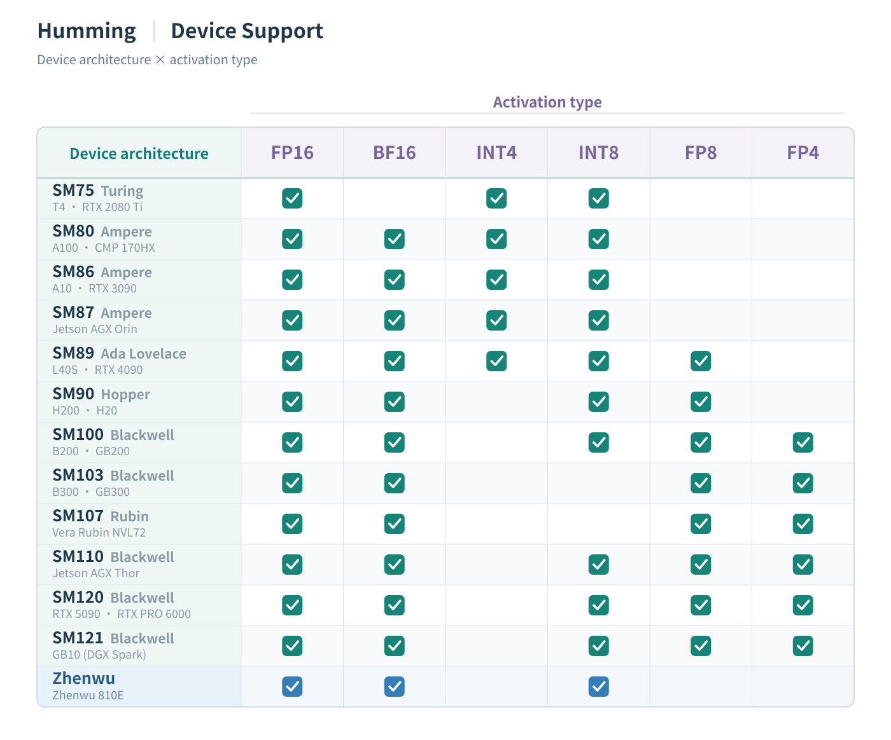

# 蚂蚁集团联合 vLLM 社区开源 Humming，让大模型量化推理更快、更通用

大模型推理正在面对一个越来越复杂的选择题。

为了降低部署成本，模型不断采用更低精度的数值格式。从 INT4、FP8，到 MXFP4、NVFP4，量化让模型变得更小，也为推理加速打开了新的空间。但更低的位宽，并不总能直接带来更快的运行速度。

原因在于，模型的量化格式、GPU 的计算能力，以及底层算子的实现，必须有效配合。同一种量化方案，换一代 GPU、调整批量大小，或者从 Dense 模型切换到 MoE 模型，都可能需要不同的计算路径。

**蚂蚁集团与 vLLM 社区联合开源 Humming，致力于用一套通用架构，支持广泛设备上的多种量化推理需求，并提供高性能的计算内核。**

Humming 的特点可以概括为三个方面：

- **设备支持广泛**：覆盖从 Turing 起的 NVIDIA 各代 GPU，以及 Zhenwu 810E 等兼容 CUDA 编程的设备。
- **量化组合丰富**：支持多种整数和浮点格式、位宽与缩放方式，同时覆盖 Dense GEMM 和 MoE GEMM。
- **执行性能出色**：在多种典型负载中，超越 vLLM Marlin、FlashInfer 和 DeepGEMM 的对应实现，并将算子层面的优化转化为实际模型服务的收益。

项目仓库：[github.com/vllm-project/humming](https://github.com/vllm-project/humming)

**让性能收益走进实际模型服务。**

在 8 张 H20、TP=8 的 DeepSeek-V4.1-Flash 测试中，保持模型的 MXFP4 权重不变，将 MoE 从 Marlin 的 W4A16 路径切换为 Humming 的 W4A8 路径，端到端吞吐提升约 **14%–43%**，平均首 token 延迟降低约 **25%–32%**。

这里，Marlin 使用 BF16 激活，Humming 使用 tokenwise FP8 激活。两组采用相同请求，输入长度约 8K token，输出长度为 256 token。

随着并发增加，Humming 的吞吐优势进一步扩大。以下选取三个代表性并发，展示输出吞吐量的变化：

| 并发 | Marlin W4A16 | Humming W4A8 |
|---:|---:|---:|
| 1 | 88.30 token/s | **100.77 token/s（+14.1%）** |
| 8 | 287.04 token/s | **383.04 token/s（+33.4%）** |
| 64 | 442.37 token/s | **633.94 token/s（+43.3%）** |

在并发 64 时，平均每输出 token 延迟也从 123.25 ms 降至 85.70 ms，降低约 **31%**。

这意味着，在相同硬件上，Humming 能够支持更高的服务吞吐，并改善用户等待首 token 和后续内容生成的体验。

**从通用的 W4A16，到更多低精度计算组合。**

WnA16 是目前应用最广泛的量化方式之一：将权重压缩到较低位宽，激活仍使用 FP16 或 BF16。它既能降低权重的存储与访存开销，又能利用广泛部署的 16-bit 计算能力。其中，W4A16 尤其受到社区关注。

Humming 对这条计算路径进行了系统优化。在 Dense W4A16 测试中，它在多数配置下领先或持平于 vLLM Marlin，并在部分 Hopper 和 Blackwell 负载中取得更大优势。

下图以 BF16/FP16 cuBLAS 为共同基准，展示了不同设备上的 Dense W4A16 表现。从小批量到大批量，Humming 根据设备能力和矩阵规模选择不同的执行配置，让低比特权重在多代 GPU 上都能获得较好的计算效率。



这种收益也延伸到了 MoE。面对 token 分散到不同专家、各专家计算规模随负载变化的特点，Humming 同时提供 Indexed 和 Grouped 两类执行路径。在博客展示的部分中大批量测试中，H20、H200 上的 MXFP4 W4A16 达到约两倍于 Marlin 的性能；B300 上部分量化组合的 Grouped 路径则达到约五倍。



这些是内核级的性能结果，其收益会受到模型结构、调度和其他计算环节的共同影响。前面的端到端测试进一步展示了 Humming 在实际模型服务中的表现。

Humming 的支持范围也不限于 W4A16。INT1、INT2、INT3，以及 FP4 到 FP8 等不同位宽的权重，都能通过统一的反量化与计算路径获得优化。开发者因此拥有更细粒度的选择，可以结合模型需求，在精度、存储和执行效率之间进行权衡。

**让已有设备也能高效运行新的量化格式。**

随着越来越多模型原生采用 MXFP4 权重，一个实际问题随之出现：部署设备可能没有对应的原生低精度计算能力。

例如，Blackwell 之前的 GPU 不支持原生 MXFP4 Tensor Core 计算。如果反量化和缩放处理效率不足，更小的权重也可能无法换来更快的推理。

Humming 为此设计了高效的 MXFP4 到 INT8/FP8 反量化路径，在内核中将权重快速转换为设备支持的计算格式。这使 H200、H20 等已有 GPU，也能在保留 4-bit 权重存储优势的同时，高效运行 **W4A8-MXFP4**。

在相应的内核测试中，这条路径在小批量下明显优于常规 W4A8 实现，在大批量下则接近 W8A8 的计算性能。

下图同时展示了 H20 和 H200 上的 W8A8 与 W4A8 表现，两类测试都以 DeepGEMM Contiguous W8A8 为基准。Humming 的 W8A8 路径在中小批量下具备竞争力；使用 MXFP4 权重的 W4A8 路径则进一步减少权重访存开销，在部分测试点获得更大的加速收益。



从 Blackwell 开始，硬件进一步提供了对 MXFP8、MXFP4 等微缩放格式的原生支持。Humming 继续利用这些能力，将 W8A8、W4A8、W4A4 等计算路径纳入同一套架构，覆盖数据中心 GPU，也覆盖工作站和个人计算设备。

在 B300 上，Humming 的优化进一步覆盖原生 MX 格式计算。下图的三个子图分别比较 W8A8、W4A8 和 W4A4，并以对应精度的 DeepGEMM Contiguous 为基准。Indexed 与 Grouped 路径在多种计算规模下都展现出良好的性能，让开发者可以结合激活精度和专家布局选择合适的计算方式。



**广泛支持背后，是统一架构。**

不同量化工具导出的模型，在数值格式、权重布局、缩放因子和零点组织方式上各有差异。不同 GPU 对数据搬运和 Tensor Core 指令的支持，也并不相同。

Humming 将这些差异拆解为三个相互衔接的环节：用统一表示描述量化计算，根据设备与负载选择执行策略，再通过共享 CUDA 组件生成内核。这样，新增一种量化格式或适配一类设备时，已有的计算与调度能力也能得到复用。

**统一量化表示，让不同模型接入同一条执行流程。** Humming 将权重类型、缩放粒度、缩放因子的格式、零点等分别表示为独立参数，激活也拥有自己的精度和量化设置。在格式与硬件约束允许的范围内，这些参数可以组合，表达不同的量化方案。

模型加载时，预处理完成格式解析、维度对齐和权重重排，将张量组织为内核需要的布局。对于低比特权重，推理时仍保留紧凑存储，在计算过程中按需解码、反量化并应用缩放，减少提前展开完整高精度权重矩阵带来的存储和搬运成本。

**按负载选择配置，让同一层模型适应不同推理阶段。** Humming 分别描述“这一层要计算什么”“使用哪种计算方式”和“怎样在设备上执行”。权重形状与量化参数、Dense 或 MoE 类型、分块与流水线等配置由此分开组织，便于在保持计算语义的同时调整执行策略。


Decode 时参与计算的 token 较少，更需要控制启动开销、提高并行度；Prefill 或较大批量下，则更需要充分利用计算吞吐与数据复用。Humming 的设备启发式会结合矩阵规模、SM 数量、共享内存和寄存器资源，选择适合的分块、流水线和调度配置。

这些选择也不局限于某一代 GPU 的最新指令。例如，在部分小批量场景中，使用异步拷贝和 MMA 的执行路径可能更有效；较大批量时，TMA 与 WGMMA/UMMA 等机制则可能更好地发挥硬件吞吐。统一架构让 Humming 能够根据负载选择合适的路径。

在模型 warmup 时，Humming 可以为不同 M 区间准备多个特化内核，并缓存编译结果。运行时根据输入规模分派到对应实现，让多种执行策略能够服务于同一层模型。

**共享 CUDA 组件，让格式与设备优化相互复用。** 在内核内部，Humming 将任务调度、数据搬运、反量化与缩放、Tensor Core 计算和输出处理组织为可组合的组件。调度器决定当前计算哪个矩阵分块、属于哪个专家；访存组件将输入和低比特权重送入流水线；数值处理组件按照量化参数处理数据，再交给 Tensor Core 完成计算。


不同执行路径可以共享适用的组件，同时采用各自需要的数据流和同步方式。例如，Warp Specialization 流水线让不同 Warp 分别承担数据搬运与计算，以重叠这些工作；常规流水线则可以采用更紧凑的组织方式。Dense、Indexed MoE 和 Grouped MoE 也能在任务映射与访存布局上分别适配，复用底层的数值处理和计算能力。

输入处理同样可以组合。激活函数与动态量化等操作可以融合在一个输入处理内核中，减少额外的启动和数据搬运。JIT 编译再根据选定的配置组合组件、消除未使用的实现分支，生成面向具体负载的内核。

这种设计让优化能够积累并复用：改进一条反量化路径、一个访存组件或一种调度策略，就能让多个适用的 Dense、MoE 配置受益，也减少了维护大量独立专用内核的成本。

目前，Humming 已支持从 Turing 起的所有 NVIDIA GPU 架构，并支持平头哥 Zhenwu 810E。统一的 JIT 架构，也为进一步扩展兼容 CUDA 编程的设备提供了基础。



**高性能之外，也保持轻量。**

Humming 的 CUDA 实现没有重量级内核框架依赖，wheel 安装包仅约 **500 KB**。它按需编译并缓存内核，无需在安装包中携带庞大的预编译内核集合。

轻量设计也带来了较低的编译开销。在 H200 服务器、CUDA 13.4 环境下的单个 W4A16 内核编译测试中，关闭编译缓存后，CUTLASS 使用 NVCC 的编译耗时为 23.35 秒，Humming 使用 NVCC 和 NVRTC 分别为 **1.82 秒和 1.88 秒**。

模型 warmup 时，Humming 还会开启并行编译。在测试中，单层 GEMM 覆盖所有支持的 M 尺寸所需的内核，编译与加载约需 **2–4 秒**。

这些设计共同降低了部署和调优的使用成本。

**开发者可以通过 vLLM 快速使用 Humming。**

Humming 已与 vLLM 深度集成。从 vLLM 0.29.0 开始，CUDA 版本的 vLLM 已自带 Humming 依赖，用户无需再单独安装。

通过 `--linear-backend` 和 `--moe-backend`，可以分别选择 Humming 作为 Dense GEMM 和 MoE GEMM 的后端。以 TP8 的后端选择为例：

```bash
vllm serve deepseek-ai/DeepSeek-V4.1-Flash-1017 \
    --tensor-parallel-size 8 \
    --linear-backend humming \
    --moe-backend humming
```

独立使用 Humming 时，可以通过 pip 安装：

```bash
pip install humming-kernels
```

仓库中还提供了 CUDA 编译依赖安装、量化格式兼容加载和激活类型配置等使用说明，方便开发者结合部署环境进行选择。

**与社区一起，拓展量化推理的可能性。**

接下来，Humming 将继续完善设备支持，跟进新一代 GPU 的计算能力，并拓展包括 Zhenwu M890 在内的更多设备。

在性能调优方面，Humming 计划引入 Autotune，在启发式配置的基础上，通过目标设备上的实际测量，为不同负载寻找更合适的执行参数。

同时，Humming 将进一步深化与 vLLM 等推理框架的集成，覆盖模型加载、量化计算、专家并行、量化通信和调度等环节，让底层内核的能力更充分地服务于完整推理流程。

蚂蚁集团与 vLLM 社区欢迎开发者试用 Humming，反馈真实部署中的需求与问题，共同完善更通用、更高效的量化推理基础设施。

**项目地址：**

[github.com/vllm-project/humming](https://github.com/vllm-project/humming)
